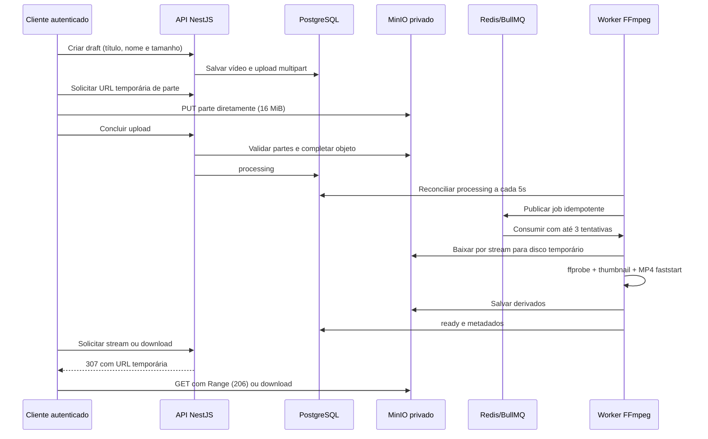

# Fase 03 — guia de operação e entrega

## Escopo e arquitetura

Esta entrega continua o backend existente. Autenticação, usuários, canais e e-mails permanecem integrados. O frontend da Fase 03, publicação pública de vídeos, busca e recomendações pertencem às fases seguintes.



O original nunca atravessa o processo HTTP da API. Partes têm 16.777.216 bytes; o limite é **10.000.000.000 bytes**, inclusive (597 partes). O cliente e o worker mantêm memória limitada; o worker precisa de disco para original e derivados. A duração máxima de cada processo FFmpeg é configurável, padrão 30 minutos.

## Iniciar

Na raiz do repositório, com Docker Desktop ligado:

```powershell
node scripts/setup-env.mjs
cd nestjs-project
docker compose up -d --build
docker compose ps
```

O gerador preserva `.env` existente e gera senhas/chaves aleatórias no primeiro uso. Nunca copie `.env` para GitHub. O exemplo contém apenas placeholders. A primeira compilação do MinIO pode demorar: o Dockerfile fixa o commit oficial `7aac2a2c5b7c882e68c1ce017d8256be2feea27f`, pois a distribuição comunitária passou a código-fonte. O repositório oficial está arquivado; esta imagem atende ao ambiente acadêmico local, e sua manutenção deve ser reavaliada antes de produção.

Migrations executam automaticamente antes da API. `storage-init` cria buckets privados; o worker espera API saudável e Redis. PostgreSQL, Redis e MinIO usam volumes persistentes. `docker compose down` preserva volumes; não use `down -v` se quiser manter os dados.

- API: http://localhost:3000
- Swagger: http://localhost:3000/api/docs, habilitado por `SWAGGER_ENABLED=true`.
- Mailpit: http://localhost:8025 (confirmação e recuperação de conta).
- MinIO: S3 em http://localhost:9000, console em http://localhost:9001. Credenciais somente no `.env` local.
- PostgreSQL e Redis: apenas rede Docker. Não conflitam com PostgreSQL já instalado na máquina.

Após editar código, execute novamente `docker compose up -d --build`. A imagem de entrega não monta o código do host.

## Upload e retomada

Cadastre uma conta via Swagger, confirme-a pelo link no Mailpit e faça login para obter `access_token`. No PowerShell, leia o token sem gravá-lo no histórico do comando:

```powershell
$env:STREAMTUBE_TOKEN = Read-Host 'Cole o access_token'
node scripts/upload-video.mjs 'C:\Videos\aula.mp4' 'Minha aula'
Remove-Item Env:STREAMTUBE_TOKEN
```

Execute esse comando na raiz do repositório. O cliente exige Node.js 22+ com fetch nativo. Transfere uma parte por vez, repete partes com falha e respeita HTTP 429. Cria um arquivo `*.streamtube-upload.json` ao lado do vídeo contendo somente ID, endereço da API e identificação local do arquivo, nunca token ou URL assinada. Se interromper, execute o mesmo comando com o mesmo arquivo; as partes existentes são consultadas no MinIO e não reenviadas. Obtenha um token novo se o anterior expirar.

Uploads incompletos expiram após 24h, com varredura de 1h pela configuração nativa do MinIO. Após expiração, cancele o rascunho e inicie um novo upload; a retomada vale enquanto o multipart existe. Para recomeçar com o cliente, remova somente seu arquivo de estado local após cancelar o rascunho.

## Contrato de API

Todas as rotas exigem Bearer JWT e propriedade do canal. Outro usuário recebe 404, evitando revelar existência do vídeo. UUID identifica a URL lógica de forma única; URLs assinadas expiram em 900 segundos e não devem ser compartilhadas.

| Método e rota | Resultado |
|---|---|
| POST `/videos` | 201, draft; body `{title,filename,size}` |
| GET `/videos/:id` | Estado, duração, metadados e URLs lógicas |
| GET `/videos/:id/upload` | Partes existentes e dimensões do multipart |
| POST `/videos/:id/parts/:partNumber` | URL PUT, tamanho exato e expiração |
| POST `/videos/:id/complete` | 202; valida partes e marca processing; repetível |
| DELETE `/videos/:id/upload` | 204; cancela apenas draft |
| POST `/videos/:id/retry` | 202; nova geração de job somente em error |
| GET `/videos/:id/stream` | 307 para MP4 inline; destino aceita Range/206 |
| GET `/videos/:id/thumbnail` | 307 para JPEG |
| GET `/videos/:id/download` | 307 para original, Content-Disposition attachment |

400 indica parâmetros/partes inválidos; 401 falta de autenticação; 404 ausente ou sem propriedade; 409 estado incompatível; 503 indisponibilidade de armazenamento. Rotas de vídeo aceitam 120 requisições/minuto por rota/IP; autenticação mantém seu limite mais restrito. O cliente trata 429.

`draft → processing → ready` ou `error`; retry faz `error → processing`. Somente ready disponibiliza mídia. A conclusão usa lock de linha e HEAD para recuperar resposta perdida do armazenamento. O estado processing é uma intenção durável: se a fila/worker estiver indisponível, o reconciliador publica ao retornar. Job ID combina vídeo e geração. Lock PostgreSQL, reconsulta de estado e atualização condicional evitam duplicação. Tentativas automáticas usam backoff exponencial; erro público é sanitizado.

## Testes e aceite

```powershell
cd nestjs-project
docker compose -f compose.yaml -f compose.test.yaml --profile test run --rm tests
```

Esse comando executa toda a suíte backend, unitários e integrações reais, e2e Supertest, `tsc --noEmit`, ESLint e build. Banco `streamtube_test`, bucket `streamtube-test` e prefixo de fila exclusivo separam dados de teste. Testes com banco executam em série. O teste de migrations cobre up/down e restaura o esquema ao terminar.

Ensaio opcional de 10 GB reais, consumindo tempo e disco:

```powershell
docker compose exec -e RUN_LARGE_UPLOAD=true nestjs-api node scripts/acceptance-10gb.mjs
```

O ensaio cria conta isolada, transmite 597 partes assinadas, mede respostas da API durante upload/processamento, aguarda ready e remove apenas os objetos e registros criados por ele. O arquivo enviado contém um vídeo curto válido com preenchimento até 10 GB; exercita transferência, armazenamento e leitura integral, mas não equivale a transcodificar 10 GB de conteúdo audiovisual complexo. Evidências e limitações estão em [progress.md](phases/phase-03-videos/progress.md).

Para regenerar OpenAPI e copiar o artefato para o host:

```powershell
docker compose exec nestjs-api npm run openapi:export
docker compose cp nestjs-api:/home/node/app/openapi.json ./openapi.json
```

## Diagnóstico e segurança

Use `docker compose logs --tail 100 nestjs-api worker` para estado de startup, e `docker compose ps` para saúde dos serviços. Logs do worker não incluem stderr de mídia, credenciais ou URLs assinadas. Um job em error preserva o original e pode ser repetido pelo dono. Mídia inválida continuará falhando até ser substituída por novo upload.

O scanner local é executado na raiz:

```powershell
node scripts/scan-secrets.mjs --history
```

Ele procura padrões de credenciais e valores secretos locais no conteúdo candidato e no histórico; mostra apenas caminhos/identificadores. É heurístico e complementa a revisão do diff. `.env`, `.mcp.json`, configurações MCP locais, relatórios e sessões de IA não integram a entrega. O exemplo MCP em `docs/codex-config.example.toml` não contém chave.

A branch `feature/phase-03-videos` foi criada a partir de `dev`, baseada no histórico original. Publicar o fork público e enviar a URL da entrega são passos posteriores à validação local, conforme solicitado. Não foi realizado push automático.
